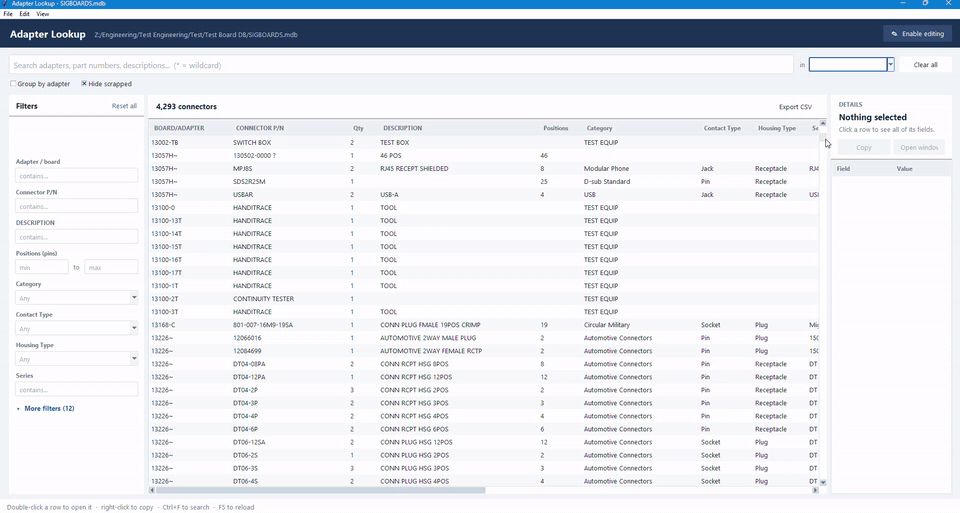

# Adapter Lookup

A Windows desktop app for searching, and editing, the **CONNECTORS** table of the
SIGBOARDS Access database. Find adapters by part number, pin count, connector
type, customer and more, then add, change or delete connector rows without
opening Access.

[▶ Watch the full-quality demo video (MP4)](docs/demo.mp4)

## Features

**Searching**
- **Instant search** across every column as you type. Several words must all match; `*` is a wildcard.
- **Filters panel**: drop-downs for columns like Category, Contact Type and Housing Type, min/max ranges for Positions (pin count) and Qty, and "contains" boxes for the rest. The most useful filters are always shown, and the rest are under **More filters**.
- **Filter chips** above the results show what's active. Click the × on a chip to remove that filter.
- **Group by adapter** shows every connector on each matching adapter, with the matching connectors highlighted.
- **Hide scrapped** leaves out rows marked as scrapped.
- **Details panel** shows every field of the selected connector.
- Copy rows or part numbers (right-click / Ctrl+C), and export results to CSV.

**Editing** (off by default, turned on with **Enable editing**)
- Add, edit, duplicate and delete connector rows.
- Drop-downs offer existing values. Capitalisation variants are matched to the existing spelling, so the data stays consistent.
- **Undo** (Ctrl+Z) for every change made in the session.
- Offers to save a **backup copy** of the database before the first edit.
- Every change goes to a **change log** (`SIGBOARDS_change_log.csv`) with the time, user, and before/after values.
- Edits are refused if the row was changed by someone else in the meantime, so nothing is overwritten by accident.

## Getting started

### Option A: the .exe (no Python needed)
1. Download **`Adapter Lookup.exe`** from this repository.
2. The Microsoft Access ODBC driver must be installed. Most PCs with Office already have it. If the app says no driver was found, install the free *Microsoft Access Database Engine 2016 Redistributable* (x64).
3. Double-click the exe. It opens the shared database at
   `Z:\Engineering\Test Engineering\Test\Test Board DB\SIGBOARDS.mdb`,
   or asks you to pick one (**File → Open database…**).

### Option B: run the Python script
1. Install Python 3.9+ (tick *Add python.exe to PATH*).
2. Double-click **`Install requirements.bat`** (installs `pyodbc` and checks for the Access driver).
3. Double-click **`Adapter Lookup.bat`**.

To try it without a database: `py adapter_lookup.py --demo`

### Rebuilding the exe
Double-click **`Build EXE.bat`**. It uses PyInstaller to write a new `Adapter Lookup.exe` into the folder.

## Keyboard shortcuts

| Key | Action |
| --- | --- |
| Ctrl+F | Jump to search |
| Esc | Clear the search box |
| F5 | Reload from the database |
| Ctrl+N | New connector (editing on) |
| F2 / double-click | Edit selected connector (editing on) |
| Ctrl+D | Duplicate selected connector (editing on) |
| Del | Delete selected rows (editing on) |
| Ctrl+Z | Undo last change |
| Ctrl+E | Export results to CSV |

## Notes
- Only the `CONNECTORS` table is used. Its settings (grouping column, scrap rules, column order) are in a block at the top of `adapter_lookup.py`.
- The table has no ID column, so a row is found by matching all of its values. Two completely identical rows can't be edited from the app; fix them in Access.
- The database itself (`*.mdb`) is not stored in this repository.

See [README.txt](README.txt) for the full user guide.
